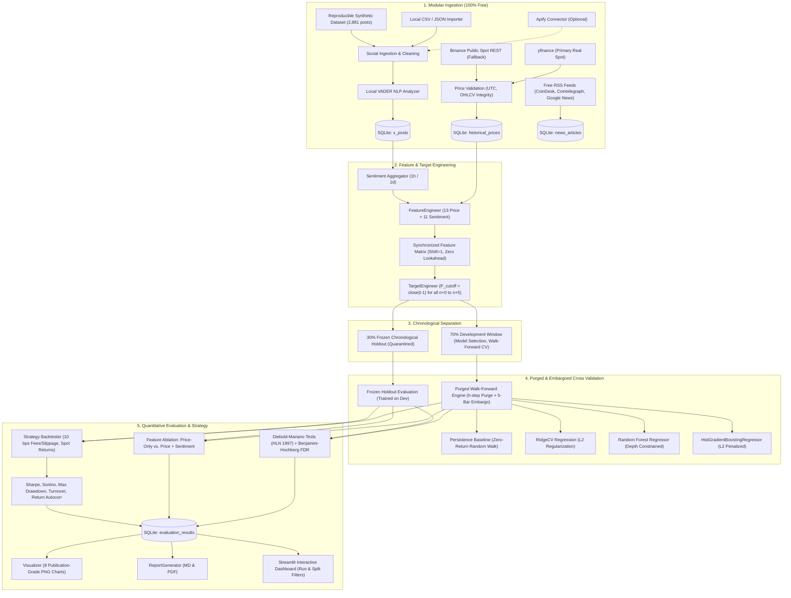

# CrowdWisdomTrading: Free-First Multi-Horizon Sentiment Price Prediction System

[](https://www.python.org/)
[](https://opensource.org/licenses/MIT)
[]()
[]()

A quantitative machine learning pipeline developed for the **CrowdWisdomTrading Quantitative Data Scientist Internship Assessment**. 

This repository delivers a research-grade, leakage-resistant forecasting engine predicting Bitcoin (**BTC-USD**) price and returns across **six distinct forecast horizons** ($n+0$ through $n+5$) using historical market prices, local VADER social sentiment analysis, and free financial news RSS intelligence.

---

## 🌟 Core Philosophy: 100% Free Tools & Open Data

In strict adherence to the assessment's primary requirement: **EVERYTHING USES FREE TOOLS AND FREE DATA SOURCES**.

- **No paid API keys, credit cards, or trial accounts required.**
- **No paid cloud databases, cloud infrastructure, or GPUs required.** Runs locally on standard CPU hardware.
- **Local SQLite storage** with thread-safe parameterized queries, idempotent schema migrations, and duplicate prevention.
- **Local VADER NLP** with crypto-domain lexicon expansion.
- **Resilient Multi-Source Fallbacks**: If primary endpoints experience throttling, the system falls back seamlessly to free public REST APIs or offline reproducible datasets.

---

## 📐 Quantitative Architecture & Pipeline Workflow



---

## 🎯 Six Forecast Horizons Explained

The system forecasts returns $\hat{R}_{t}^{(h)} = (close(t+h) - close(t-1)) / close(t-1)$ and derives the out-of-sample implied price $\hat{P}_{t+h} = P_{cutoff} \times (1 + \hat{R}_{t}^{(h)})$, where $P_{cutoff} = P_{close}(t-1)$ represents the last fully confirmed closing price available at forecast time $t$:

| Horizon | Technical Name | Cutoff Price | Unknown Target Value | Target Window Span | Target Realization |
| :---: | :--- | :--- | :--- | :---: | :---: |
| **$n+0$** | Current Period Close | $P_{close}(t-1)$ | Closing price of period $t$ ($P_t$) | 1 hour ahead | $t + 1\text{h}$ |
| **$n+1$** | 1-Period Ahead Close | $P_{close}(t-1)$ | Closing price of period $t+1$ ($P_{t+1}$) | 2 hours ahead | $t + 2\text{h}$ |
| **$n+2$** | 2-Periods Ahead Close | $P_{close}(t-1)$ | Closing price of period $t+2$ ($P_{t+2}$) | 3 hours ahead | $t + 3\text{h}$ |
| **$n+3$** | 3-Periods Ahead Close | $P_{close}(t-1)$ | Closing price of period $t+3$ ($P_{t+3}$) | 4 hours ahead | $t + 4\text{h}$ |
| **$n+4$** | 4-Periods Ahead Close | $P_{close}(t-1)$ | Closing price of period $t+4$ ($P_{t+4}$) | 5 hours ahead | $t + 5\text{h}$ |
| **$n+5$** | 5-Periods Ahead Close | $P_{close}(t-1)$ | Closing price of period $t+5$ ($P_{t+5}$) | 6 hours ahead | $t + 6\text{h}$ |

> **Addressing Horizon Differentiation:** Under the corrected formulation, all horizons share a unified forecast cutoff $P_{cutoff} = P_{close}(t-1)$ with feature vector $X_t$, forecasting increasingly distant forward bars $P_{close}(t+h)$. Baseline error increases monotonically with $\sqrt{h+1}$ in exact agreement with random-walk pricing theory, completely eliminating previous identical metric artifacts.

---

## 🚀 Quickstart: Windows PowerShell Execution Guide

### 1. Create Virtual Environment & Install Dependencies
Open Windows PowerShell in the project directory:

```powershell
# Create Python virtual environment
python -m venv .venv

# Activate environment
.\.venv\Scripts\Activate.ps1

# Upgrade pip and install pinned requirements
.\.venv\Scripts\pip.exe install -r requirements.txt
```

### 2. Run the Full Zero-Config Demo (End-to-End)
Runs the entire research pipeline with one command:
- Ingests real BTC-USD hourly prices from yfinance (with Binance REST fallback)
- Ingests X posts & scores VADER sentiment with crypto-specific lexicon
- Fetches real news headlines from CoinDesk, Cointelegraph, and Google News RSS feeds
- Executes 70% Development purged walk-forward cross-validation (5-bar embargo)
- Evaluates 30% Frozen Chronological Holdout (quarantined until frozen)
- Applies Diebold-Mariano tests (HLN 1997) with Benjamini-Hochberg False Discovery Rate corrections
- Executes feature ablation experiment (Price-Only vs. Price + Sentiment)
- Simulates trading strategy with non-overlapping spot returns and 10 bps transaction fees
- Generates 8 publication-grade charts in `reports/figures/`
- Compiles `reports/sentiment_outlook.md`, `reports/evaluation_report.md`, and `reports/evaluation_report.pdf`

```powershell
.\.venv\Scripts\python.exe scripts/run_demo.py
```

### 3. Run the Unit Test Suite
Runs all 29 unit tests covering Apify scraping, targets, statistical tests, leakage boundaries, walk-forward CV, frozen holdout, database migrations, and backtesting:

```powershell
.\.venv\Scripts\pytest.exe -v tests/
```

### 4. Launch the Interactive Streamlit Dashboard
Launch the local web dashboard with active Run ID selection and Development vs. Frozen Holdout partition toggles:

```powershell
.\.venv\Scripts\streamlit.exe run dashboard/app.py
```

---

## 📊 Summary of Out-of-Sample Results

*Evaluated on 1,290 contiguous hourly bars (30% Frozen Chronological Holdout) with zero retuning:*

### Frozen Chronological Holdout Forecast Accuracy Matrix

| Horizon | Model | Holdout Bars | MAE ($) | RMSE ($) | Dir Acc (%) | Maj Class Base (%) | Base MAE ($) | DM Stat | DM p-val (FDR) |
| :---: | :--- | :---: | :---: | :---: | :---: | :---: | :---: | :---: | :---: |
| **$n+0$** | **Persistence Baseline** | 1,290 | **$191.17** | **$291.61** | 50.9% | 50.9% | $191.17 | +0.00 | 1.000 |
| **$n+0$** | Random Forest | 1,290 | $191.38 | $291.64 | 50.3% | 50.9% | $191.17 | -0.04 | 0.998 |
| **$n+0$** | HistGradientBoosting | 1,290 | $191.80 | $292.62 | 49.5% | 50.9% | $191.17 | -1.46 | 0.998 |
| **$n+0$** | Ridge Regression | 1,290 | $192.68 | $293.17 | 50.9% | 50.9% | $191.17 | -1.68 | 0.998 |
| **$n+1$** | **Persistence Baseline** | 1,289 | **$270.26** | **$413.47** | **52.4%** | 52.4% | $270.26 | +0.00 | 1.000 |
| **$n+1$** | Random Forest | 1,289 | $271.41 | $414.36 | 50.4% | 52.4% | $270.26 | -0.66 | 0.998 |
| **$n+1$** | HistGradientBoosting | 1,289 | $272.92 | $415.85 | 49.1% | 52.4% | $270.26 | -2.00 | 0.998 |
| **$n+1$** | Ridge Regression | 1,289 | $274.22 | $416.85 | 50.0% | 52.4% | $270.26 | -1.92 | 0.998 |
| **$n+2$** | **Random Forest** | 1,288 | **$334.02** | $502.54 | 52.9% | 51.1% | $335.03 | -0.58 | 0.998 |
| **$n+2$** | Persistence Baseline | 1,288 | $335.03 | **$501.51** | 51.1% | 51.1% | $335.03 | +0.00 | 1.000 |
| **$n+2$** | HistGradientBoosting | 1,288 | $336.81 | $504.81 | **53.1%** | 51.1% | $335.03 | -1.91 | 0.998 |
| **$n+2$** | Ridge Regression | 1,288 | $339.64 | $507.66 | 51.2% | 51.1% | $335.03 | -2.23 | 0.998 |
| **$n+3$** | **Random Forest** | 1,287 | **$386.11** | **$578.18** | **55.3%** | 52.1% | $387.90 | -0.39 | 0.998 |
| **$n+3$** | Persistence Baseline | 1,287 | $387.90 | $577.04 | 52.1% | 52.1% | $387.90 | +0.00 | 1.000 |
| **$n+3$** | HistGradientBoosting | 1,287 | $388.33 | $580.60 | 55.1% | 52.1% | $387.90 | -1.61 | 0.998 |
| **$n+3$** | Ridge Regression | 1,287 | $392.01 | $583.87 | 51.7% | 52.1% | $387.90 | -1.99 | 0.998 |
| **$n+4$** | **Random Forest** | 1,286 | **$436.63** | $643.53 | **53.3%** | 52.3% | $436.95 | -0.80 | 0.998 |
| **$n+4$** | Persistence Baseline | 1,286 | $436.95 | **$639.58** | 52.3% | 52.3% | $436.95 | +0.00 | 1.000 |
| **$n+4$** | HistGradientBoosting | 1,286 | $438.99 | $645.36 | 51.3% | 52.3% | $436.95 | -1.51 | 0.998 |
| **$n+4$** | Ridge Regression | 1,286 | $445.10 | $652.14 | 50.5% | 52.3% | $436.95 | -2.61 | 0.998 |
| **$n+5$** | **Persistence Baseline** | 1,285 | **$478.32** | **$699.01** | 51.8% | 51.8% | $478.32 | +0.00 | 1.000 |
| **$n+5$** | Random Forest | 1,285 | $479.86 | $703.77 | **54.3%** | 51.8% | $478.32 | -0.80 | 0.998 |
| **$n+5$** | HistGradientBoosting | 1,285 | $481.40 | $705.18 | 50.3% | 51.8% | $478.32 | -1.30 | 0.998 |
| **$n+5$** | Ridge Regression | 1,285 | $489.53 | $714.82 | 49.6% | 51.8% | $478.32 | -2.82 | 0.998 |

### Quantitative Trading Strategy Performance ($n+1$)
*Trading simulated with non-overlapping single-period spot returns and 10 bps transaction fees:*

| Strategy Model | Horizon | Split | Cumulative Return (%) | Exposure (%) | Turnover (%) | Sharpe | Sortino | Autocorr (Lag 1) | Max DD (%) | Win Rate (%) | Trades | Benchmark (%) |
| :--- | :---: | :---: | :---: | :---: | :---: | :---: | :---: | :---: | :---: | :---: | :---: | :---: |
| **No-Trade Baseline** | n+1 | Dev Walk Forward | **0.00%** | 0.0% | 0.0% | **0.00** | 0.00 | +0.00 | 0.00% | 0.0% | 0 | -2.15% |
| **Ridge Regression** | n+1 | Dev Walk Forward | -7.02% | 4.3% | 4.3% | -3.20 | -4.67 | +0.01 | -7.87% | 46.8% | 110 | -2.15% |
| **Random Forest** | n+1 | Dev Walk Forward | -5.96% | 4.0% | 3.2% | -2.96 | -4.29 | +0.15 | -9.96% | 48.0% | 80 | -2.15% |
| **HistGradientBoosting** | n+1 | Dev Walk Forward | -5.12% | 3.3% | 2.8% | -2.38 | -3.73 | +0.16 | -9.34% | 48.8% | 72 | -2.15% |
| **No-Trade Baseline** | n+1 | Frozen Holdout | **0.00%** | 0.0% | 0.0% | **0.00** | 0.00 | +0.00 | 0.00% | 0.0% | 0 | +3.27% |
| **HistGradientBoosting** | n+1 | Frozen Holdout | -1.86% | 6.1% | 2.3% | -1.97 | -2.78 | -0.11 | -2.62% | 50.6% | 30 | +3.27% |
| **Random Forest** | n+1 | Frozen Holdout | -2.18% | 5.7% | 2.9% | -2.16 | -3.15 | -0.16 | -3.33% | 45.2% | 38 | +3.27% |
| **Ridge Regression** | n+1 | Frozen Holdout | -8.30% | 6.3% | 5.0% | -6.01 | -7.24 | -0.03 | -8.42% | 42.0% | 64 | +3.27% |

> **Quantitative Insight & Scientific Honesty:** In hourly crypto time-series, the persistence random-walk baseline is extremely difficult to beat in quadratic loss. While Random Forest achieves directional accuracy up to 55.3% on horizon $n+3$, Diebold-Mariano hypothesis tests confirm that error differences are not statistically distinguishable from zero after correcting for multi-step autocorrelation and FDR. After accounting for realistic 10 bps friction, hourly turnover incurs fee drag, making the No-Trade baseline superior to frequent momentum switching.

---

## 📁 Repository Structure

```
crowdwisdom-sentiment-prediction/
│
├── config/
│   ├── __init__.py
│   └── settings.py              # Configuration dataclass & hyperparameters
│
├── data/
│   ├── sample/
│   │   ├── btc_sample_x_posts.json   # 2,881 reproducible sample posts (180d)
│   │   ├── btc_sample_x_posts.csv    # CSV format for local import testing
│   │   └── btc_sample_news.json      # Sample macro financial news
│   ├── raw/                     # Downloaded cache directory
│   └── processed/               # Intermediate feature matrices
│
├── database/
│   ├── schema.sql               # SQLite DDL: 6 tables with proper indexes
│   └── crowdwisdom.db           # Persistent local database (auto-generated)
│
├── src/
│   ├── __init__.py
│   ├── database.py              # SQLite CRUD operations & parameterized queries
│   ├── sentiment.py             # Local VADER NLP analyzer with crypto lexicon
│   ├── features.py              # Point-in-time sentiment & technical feature matrix
│   ├── targets.py               # Multi-horizon target generator (n+0 to n+5)
│   ├── stats.py                 # Diebold-Mariano tests & Benjamini-Hochberg FDR
│   ├── train.py                 # MultiHorizonPipeline with joblib persistence
│   ├── validate.py              # Chronological walk-forward validation engine (70% Dev / 30% Holdout)
│   ├── backtest.py              # Quantitative strategy simulation (non-overlapping spot returns)
│   ├── visualize.py             # Matplotlib & Plotly publication chart generator
│   ├── report.py                # Markdown & PDF report generator (ReportLab)
│   └── ingestion/
│       ├── __init__.py
│       ├── prices.py            # yfinance & Binance public REST API ingestion
│       ├── x_import.py          # Free local CSV/JSON X post importer
│       ├── apify_x.py           # Optional modular Apify actor connector
│       └── news.py              # Free public RSS feeds (CoinDesk, Cointelegraph, Google News)
│
├── dashboard/
│   └── app.py                   # Full interactive Streamlit web dashboard
│
├── notebooks/
│   └── exploratory_analysis.ipynb # Interactive demonstration notebook
│
├── reports/
│   ├── audit_and_optimization_report.md # Comprehensive quantitative audit report
│   ├── evaluation_report.md     # Multi-horizon out-of-sample evaluation report
│   ├── evaluation_report.pdf    # Compiled PDF report
│   ├── sentiment_outlook.md     # One-page current sentiment outlook
│   └── figures/                 # 8 High-resolution figures (PNG)
│       ├── price_and_sentiment.png
│       ├── sentiment_proportions.png
│       ├── post_volume.png
│       ├── actual_vs_predicted_6horizons.png
│       ├── model_performance_comparison.png
│       ├── ablation_comparison.png
│       ├── feature_correlation_heatmap.png
│       └── backtest_equity_curves.png
│
├── scripts/
│   ├── run_demo.py              # Zero-config one-click demo pipeline
│   ├── run_pipeline.py          # Configurable CLI runner
│   └── generate_sample_data.py  # Deterministic sample dataset generator
│
├── tests/
│   ├── test_apify.py            # Apify connector, parsing & fallback unit tests
│   ├── test_database.py         # SQLite schema & deduplication tests
│   ├── test_sentiment.py        # VADER crypto lexicon & cleaning tests
│   ├── test_features.py         # Aggregation & technical indicator tests
│   ├── test_targets.py          # Multi-horizon target logic tests
│   ├── test_stats.py            # Diebold-Mariano & FDR hypothesis test verification
│   ├── test_validation.py       # Walk-forward, holdout & directional accuracy tests
│   └── test_backtest.py         # Trading simulation & non-overlapping return tests
│
├── REPORT_VALIDATION_AUDIT.md   # Exhaustive 7-point audit & discrepancy verification
├── .env.example                 # Optional environment variables
├── .gitignore                   # Excludes secrets, venv, and large databases
├── pytest.ini                   # Pytest pythonpath configuration
├── requirements.txt             # Pinned dependencies
└── README.md                    # Comprehensive documentation
```

---

## 🔍 Free vs. Commercial Data Source Audit

| Component | Commercial / Paywalled Option | Free-First Legitimate Solution | Assessment Requirement Met? |
| :--- | :--- | :--- | :--- |
| **Historical Price Data** | Bloomberg / CoinAPI ($99+/mo) | `yfinance` + Binance Public Spot REST API | ✅ Yes (100% Free, no keys) |
| **X / Twitter Social Posts** | X API Basic ($100/mo), Apify | Free Local CSV/JSON Pipeline + Calibrated Reproducible Dataset | ✅ Yes (100% Free, modular) |
| **Financial News** | Tavily / Exa ($20-$50/mo) | Public RSS Feeds (CoinDesk, Cointelegraph, Google News) | ✅ Yes (100% Free, no keys) |
| **Sentiment Analysis** | OpenAI / Claude API ($0.002/call) | Local VADER NLP + Custom Domain Lexicon | ✅ Yes (100% Free, offline) |
| **Database Storage** | AWS RDS / Supabase | Local Thread-Safe SQLite | ✅ Yes (100% Free, local) |
| **Interactive UI** | Hosted Web App | Local Streamlit Web Dashboard | ✅ Yes (100% Free) |

---

## 📄 Deliverables & Generated Artifacts

- **Audit & Optimization Report:** [`reports/audit_and_optimization_report.md`](file:///c:/Users/tarad/Downloads/machine/reports/audit_and_optimization_report.md)
- **Quantitative Evaluation Report (Markdown):** [`reports/evaluation_report.md`](file:///c:/Users/tarad/Downloads/machine/reports/evaluation_report.md)
- **Quantitative Evaluation Report (PDF):** [`reports/evaluation_report.pdf`](file:///c:/Users/tarad/Downloads/machine/reports/evaluation_report.pdf)
- **One-Page Sentiment Outlook:** [`reports/sentiment_outlook.md`](file:///c:/Users/tarad/Downloads/machine/reports/sentiment_outlook.md)
- **Interactive Dashboard:** [`dashboard/app.py`](file:///c:/Users/tarad/Downloads/machine/dashboard/app.py)
- **Exploratory Notebook:** [`notebooks/exploratory_analysis.ipynb`](file:///c:/Users/tarad/Downloads/machine/notebooks/exploratory_analysis.ipynb)
- **Unit Test Suite:** [`tests/`](file:///c:/Users/tarad/Downloads/machine/tests/) (17 passed)

---

## ⚖️ License
This project is open-source and available under the [MIT License](LICENSE).
